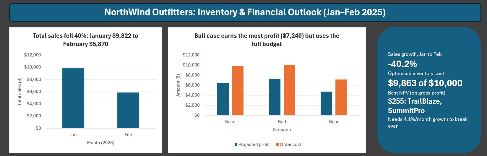
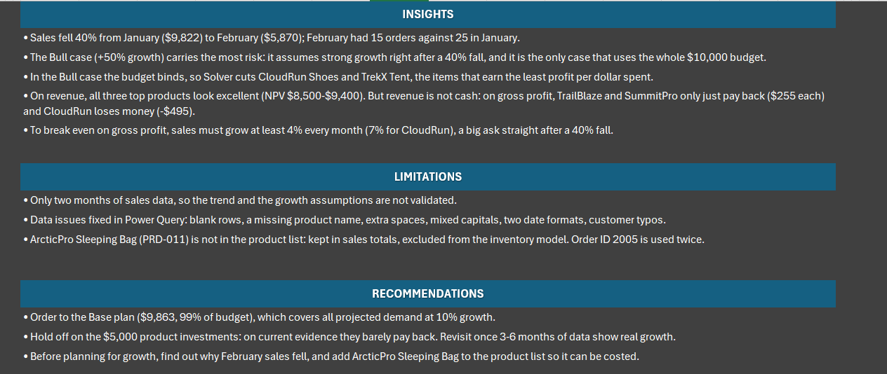
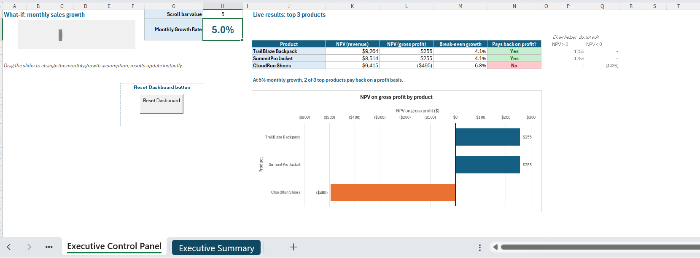

# Inventory Optimisation & Financial Forecast Model (Excel)

**Tools:** Excel: Power Query, Solver, Scenario Manager, Goal Seek, NPV/IRR, dynamic arrays (XLOOKUP, UNIQUE, SORT, FILTER), form controls, VBA
**Skills:** data cleaning, optimisation, scenario analysis, investment appraisal, business communication

## The question

NorthWind Outfitters, an outdoor gear retailer, has two months of sales data (January and February 2025) and a **$10,000 procurement budget**. Management asked two questions:

1. **How much stock should we reorder?** And which products should get priority when the budget can't cover everything?
2. **What is the financial outlook for our top products?**

## Key findings

- **Sales fell 40% from January ($9,822) to February ($5,870).** February had 15 orders against 25 in January.
- **At 10% growth (Base case), the $10,000 budget covers all projected demand.** Solver orders everything for **$9,863**, with a projected profit of **$6,491**.
- **At 50% growth (Bull case), the budget binds.** Solver drops CloudRun Shoes and cuts TrekX Tent, the two products that earn the least profit per dollar spent, to reach **$7,240** profit on $9,998.
- **On revenue, all three top products look like excellent investments** (NPV of $8,500–$9,400 on $5,000). **But revenue isn't cash.** Each sale also costs the product's standard cost. On gross profit:
  - TrailBlaze Backpack and SummitPro Jacket only just pay back (NPV **$255** each).
  - CloudRun Shoes **loses money** (NPV **−$495**).
- **Break-even growth:** to pay back on gross profit, sales must grow at least **4.1% every month** (6.8% for CloudRun), straight after a 40% fall.
- **Extra budget only helps if demand grows.** In the Bull case, each extra $1,000 above $10,000 adds about $450–$490 of profit, until all demand is covered at $13,643. In the Base case it adds nothing.

## Try it: the what-if panel

On the **Executive Control Panel**, drag the growth slider from 1% to 10% a month. You'll see the three product investments move from losing money to paying back on a gross-profit basis:

| Monthly growth | TrailBlaze | SummitPro | CloudRun | Pay back |
|---|---|---|---|---|
| 1% | −$797 | −$797 | −$1,397 | 0 of 3 |
| 5% | $255 | $255 | −$495 | 2 of 3 |
| 10% | $2,029 | $2,029 | $1,025 | 3 of 3 |

## Recommendation

- **Order to the Base plan** ($9,863, 99% of budget).
- **Hold off on the $5,000 product investments.** On a profit basis they barely pay back, and only if strong growth returns. Revisit once 3–6 months of data confirm the trend.
- **Treat the Bull case as the riskiest scenario.** It assumes strong growth straight after a steep fall. Find out why February sales dropped before planning for growth.

## Approach

1. **Power Query: cleaning and combining the data.** Combined the January and February files and joined them to the product list **by product ID**. Matching by name failed on the dirty text, so this was essential. Fixes made:
   - removed blank rows
   - filled in a missing product name
   - removed extra spaces and fixed inconsistent capitals
   - read two different date formats correctly (`2025-02-06` and US-style `02/05/2025` = 5 Feb)
   - corrected salesperson and customer typos
2. **Model Data sheet.** A product-level summary using UNIQUE, SUMIFS and XLOOKUP (wrapped in IFERROR), a nested IF/AND/OR stock-status flag, and a SUMPRODUCT weighted average cost ($41.33).
3. **Inventory Model sheet.**
   - Projected demand = quantity sold × growth factor.
   - **Goal Seek** found the reorder quantity for 100% service level on the weakest product.
   - **Solver** (integer programming, a knapsack problem) maximised profit under the $10,000 budget, with order quantities capped at projected demand.
4. **Scenario Manager.** Base (×1.1), Bull (×1.5) and Bear (×0.8). Each scenario stores the growth factor together with its own Solver solution, so costs and profits are comparable across scenarios.
5. **Financials sheet.**
   - The top 3 products by revenue, found with SORT and FILTER.
   - A 12-month cash-flow projection for each, starting from actual February revenue.
   - NPV at a 10% annual rate, plus IRR (shown both monthly and annualised).
6. **Revenue vs profit comparison.**
   - NPV and IRR recalculated on gross profit (price minus standard cost) as well as on revenue.
   - A live **break-even growth** rate for each product: the monthly growth at which NPV is exactly $0. This is the same answer Goal Seek gives, calculated with RATE so it updates automatically.
7. **Budget sensitivity.** Solver re-run at budgets from $6,000 to $14,000 for the Base and Bull cases, with a chart of profit against budget.
8. **Executive Control Panel.** A what-if panel: a scroll bar sets the monthly growth rate (1–20%). Next to it, a live table, message and chart show which products pay back at that rate. A recorded macro (Reset_Dashboard) resets the growth rate and refreshes the data.

## Data quality issues found

| Issue | How it was handled |
|---|---|
| 7 blank rows in the February file | Removed |
| One order with no product name (PRD-004) | Name taken from the product list via its ID |
| Extra spaces and mixed capitals (" Summitpro Jacket", "west", "alex smith") | Trimmed and standardised |
| Two date formats in February | Both parsed explicitly |
| Typos ("Jonh King", "Outdoor Wirld", "Trail Hutt", "Ridge Gears") | Corrected |
| PRD-011 ArcticPro Sleeping Bag isn't in the product list | Kept in sales totals, excluded from the inventory model (no cost available) |
| Order ID 2005 used for two different orders | Kept both rows and flagged |

## Limitations

- **Only two months of data.** Growth rates are assumptions, not forecasts.
- **The profit-based NPV uses standard cost only.** It ignores overheads, so even $255 is optimistic.
- **Solver maximises profit on this reorder only.** It ignores stock already on hand and lead times.

## Files

| File | Contents |
|---|---|
| `excel/NorthWind_Inventory_Financial_Model.xlsm` | The full model (macro-enabled). Start at the **Cover** sheet, which has key results, a sheet guide and a colour key. Yellow cells are inputs you can change. If macros are blocked after downloading: right-click → Properties → Unblock. |
| `data/*.csv` | Raw January and February sales and the product list |

## About this project

This was a capstone exercise from my data analytics bootcamp. I later revisited it, with help from an AI assistant (Claude), to:

- fix the data cleaning (matching by product ID instead of name)
- correct the cost lookup and the NPV formulas
- rebuild the scenarios so each one carries its own Solver result
- rewrite the executive summary to match the corrected numbers
